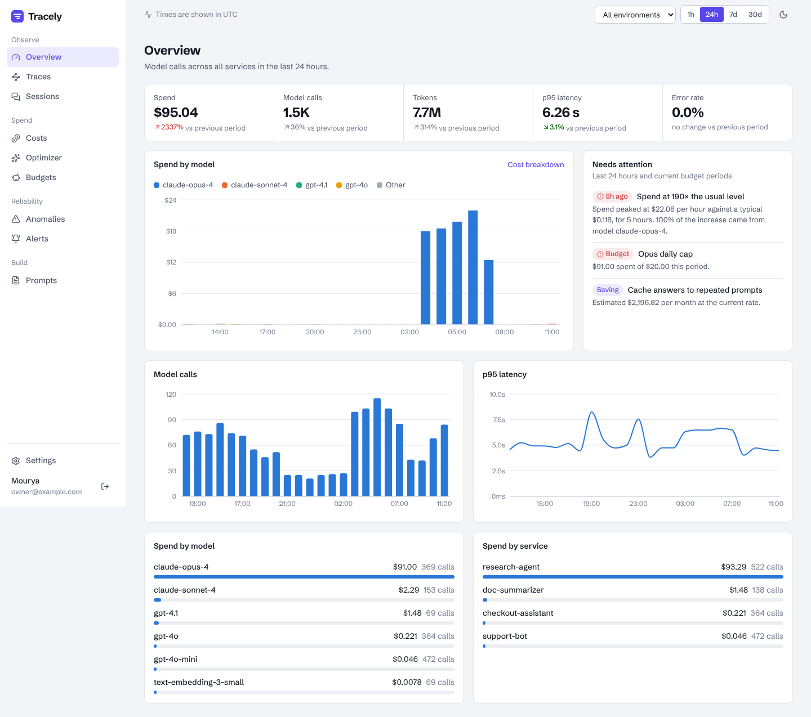
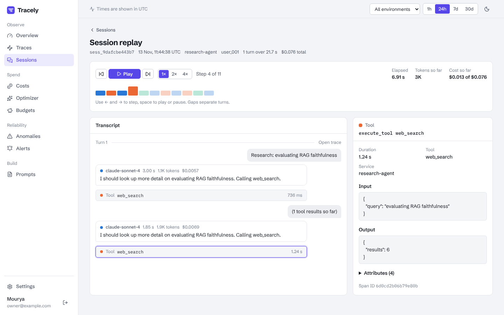
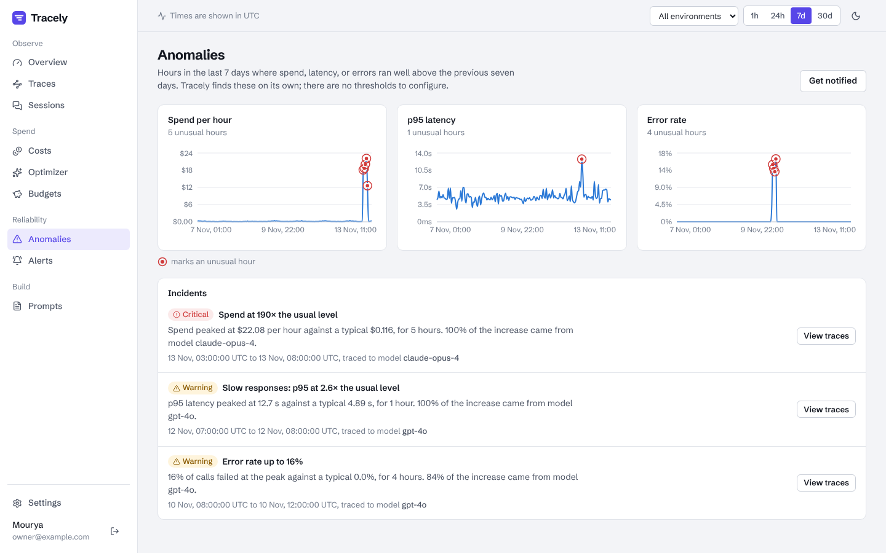

# Tracely

Observability for LLM applications: traces, cost, and reliability in one self-hosted product. Tracely is OpenTelemetry-native, so it reads the standard GenAI semantic conventions from any SDK and stores them in ClickHouse.



| Session replay | Anomalies |
|---|---|
|  |  |

Screenshots show the bundled demo data.

## What it does

| Area | Feature |
|---|---|
| Observe | **Traces** with a span waterfall, prompts, responses, tokens, and errors. Full-text search across prompts and responses. |
| | **Sessions** group a conversation or agent run, and **session replay** steps through it call by call with running cost. |
| Spend | **Costs** by model, service, user, and provider, priced from an editable price list. |
| | **Optimizer** finds savings in your own traffic: smaller-model candidates, repeated prompts, cacheable prompt openings, failed calls, oversized context. |
| | **Budgets** per model, service, user, or environment, with a forecast for the period. |
| Reliability | **Anomalies** in spend, latency, and error rate, detected without thresholds and explained in a sentence that names the cause. |
| | **Alerts** to Slack or any webhook for budgets and anomalies. |
| Build | **Prompt hub** with versions, fetched by your app at runtime. |
| Ingest | OTLP over HTTP (protobuf and JSON). A **Python SDK** that instruments OpenAI and Anthropic in one line. |

## Quick start

**With Docker**

```bash
cp env.example .env        # set TRACELY_SECRET and TRACELY_CLICKHOUSE_PASSWORD
docker compose up -d --build
```

Open http://localhost:3000, create the owner account, then create an API key under **Settings**.

**Without Docker** (development)

```bash
pip install chdb           # embedded ClickHouse used as a local stand-in
./scripts/dev.sh
```

**Send data**

```bash
git clone https://github.com/mouryadwarapudii/tracely-python
pip install -e tracely-python
```

```python
import tracely
tracely.init(api_key="tr_...", endpoint="http://localhost:3000", service_name="my-app")
# OpenAI and Anthropic calls are now traced.
```

Or load two weeks of demo data:

```bash
cd src/client && TRACELY_API_KEY=tr_... npm run seed
```

## Repository layout

```
tracely/
├── src/client/        Dashboard, ingest endpoint, API, alert evaluator (Next.js + TypeScript)
├── sdk/               SDK notes. The Python SDK lives in its own repository (tracely-python)
├── examples/          Runnable sample apps
├── docs/              Documentation site content
├── assets/            OpenTelemetry Collector config
├── scripts/           Local development helpers
└── docker-compose.yml
```

## Documentation

Start at [docs/latest/introduction.mdx](docs/latest/introduction.mdx). Key pages: [Quickstart](docs/latest/quickstart.mdx), [Architecture](docs/latest/architecture.mdx), [Python SDK](docs/latest/sdk/overview.mdx), [Self-hosting](docs/latest/self-hosting/docker.mdx), [Roadmap](docs/latest/roadmap.mdx).

## Status

Version 0.1, an MVP. The features above work end to end and are covered by tests; the [roadmap](docs/latest/roadmap.mdx) lists what is not built yet, including teams and roles, evaluations, and more SDKs.

## Tests

```bash
cd src/client && npm run typecheck && npm test
# SDK tests run in the tracely-python repository: pip install -e ".[dev]" && pytest
```

## License

No license has been chosen yet, which means all rights are reserved. Add a `LICENSE` file before publishing the repository.
